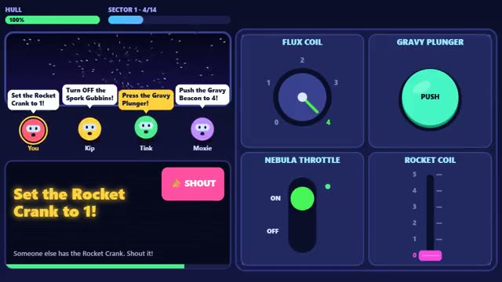

# Ship Panic

Shout the orders. Flip the switches. Don't explode. A multiplayer starter game from [Multiplayer Agent](https://multiplayeragent.com): 2D, co-op, 2–6 players, with bots that fill empty seats.

## How it plays

Your screen shows orders for someone else's panel: shout them out. Their screens show orders for yours. Fix enough in time to warp to the next sector; every miss cracks the hull, and each sector is faster.

**Controls:** Click or tap switches, dials and buttons, drag sliders; SHOUT (or Space) reads your order to the crew.

## Make it yours in the Game Builder

Open the [Game Builder](https://multiplayeragent.com), choose **Start from a starter game** and pick Ship Panic. It opens as version 1 in your studio, ready to play and publish. Then ask for changes, for example:

- Add a meteor shower that shakes everyone's screen
- Make it a submarine instead of a spaceship
- Add a control that has to be held down

## Run it yourself

1. Get a free publishable key (`pk_…`) at [multiplayeragent.com](https://multiplayeragent.com).
2. In `index.html`, put it in place of `pk_REPLACE_ME` in the `MP_CONNECT` block.
3. Open `index.html` in a browser. No build step and no server needed.

Without a key it still runs, offline against bots.

## How it is built

- One `index.html`. The comment at the top of the script maps the code and explains the multiplayer.
- **Host-run rules:** The host's browser makes every order, sends it to someone else's screen and checks the panels; if it leaves, the next player takes over.
- **Bots:** Bots fill empty seats: they shout their orders and work their own panels, a little slowly.
- **Live sync:** Every switch you flip shows up for the crew at once.
- **Leaderboard:** The most orders your crew fixed in one flight.
- Part names are two word lists (PARTS): add words to get new parts.
- `?attract` runs it offline with bots only. The preview video is recorded from it.

## License

MIT.
